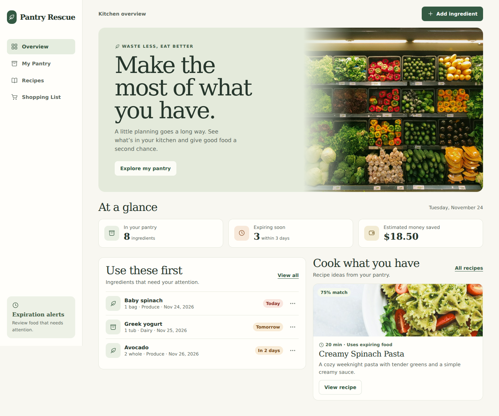
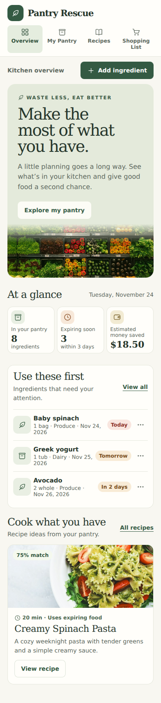

# Pantry Rescue

Pantry Rescue is a browser-based inventory and meal-planning app for households that want to use food before it goes to waste. It helps home cooks see what they already have, decide what to cook next, and buy only the ingredients they’re missing.

- **Pantry inventory** lets you add, edit, use, or discard ingredients. Each entry records a category, quantity, expiration date, and estimated value in USD.
- **Expiration alerts** surface ingredients due today through the next three days and flag items already past date.
- **Recipe recommendations** rank four recipes by the share of ingredients you have. Ingredients due soon break ties. Each recipe shows its preparation steps and what’s missing.
- **Shopping list** accepts missing recipe ingredients and manual entries. Check off items as you shop or remove them when you’re done.
- **Estimated savings** increases by the entered value when you mark a whole pantry entry as used. Discarded entries add nothing.

## Run locally

1. Open a terminal at the repository root. If you are using VS Code’s Dev Containers extension, open the repository in the supplied dev container.
2. Start the app from your laptop terminal:

   ```bash
   python3 -m http.server 8000 --bind 127.0.0.1 --directory project
   ```

   From inside a dev container, use the command below, then forward port `8000` in VS Code’s **Ports** panel if it has not been forwarded automatically.

   ```bash
   python3 -m http.server 8000 --bind 0.0.0.0 --directory project
   ```

3. Open [http://localhost:8000/](http://localhost:8000/). Keep the terminal open while using the app. Press **Ctrl+C** to stop the server.

Running the app requires Python 3 and a modern browser. Node.js 20 or newer runs the unit tests. The application uses plain HTML, CSS, and JavaScript modules, with bundled photos and no build step or API keys.

## Screenshots

Both screenshots show the sample household inventory.

| Desktop overview | Mobile overview |
| --- | --- |
|  |  |

## Data and estimates

The first visit seeds eight ingredients with dates relative to that day and an illustrative savings balance of $18.50. Inventory, shopping items, and savings are stored in browser `localStorage` for the current origin. Use the same URL and browser profile to retain your data. Clearing site data restores the sample state on the next visit.

Recipe matching uses ingredient names after normalizing case and whitespace. The match checks ingredient presence and ignores amounts, unit conversions, and substitutions. Past-date entries are excluded. Savings represents the entered value of ingredients marked as used. Actual cash savings will vary.

## Testing and assignment evidence

Run from the repository root:

```bash
node --test project/model.test.mjs
```

### Verified development environment

| Command | Verified version |
| --- | --- |
| `python3 --version` | Python 3.14.4 |
| `node --version` | Node.js v26.13.1 |
| `codex --version` | Codex CLI 0.172.0 |

`findmnt --mountpoint /data` confirmed that `/data` was mounted read/write. During final QA, a temporary file written at the workspace root was readable with identical contents under `/data`. The probe was removed, and a subsequent comparison confirmed that the workspace README and `/data/README.md` matched byte for byte.

### Verified test results

**Unit tests: 6 passed, 0 failed.** The tests cover calendar-day calculations and invalid dates, ingredient input validation, sample dates and recipe ordering, normalized matching and urgency tie-breaking, shopping-list deduplication, and counting ingredient value only once toward savings.

**Chromium browser flows: 2 passed, 0 failed.**

- The comprehensive QA flow covered inventory management, expiration filters, recipe-to-shopping-list actions, savings, reload persistence, and layouts from 320 to 1440 pixels. It recorded no browser console errors or failed requests. Automated axe scans reported zero violations across seven tested views and dialogs.
- The smoke flow independently checked expiration alerts, ingredient validation and editing, adding a missing recipe ingredient to the shopping list, persistence after reload, updated savings, and responsive layouts.

### Coding-agent assignment and revisions

The coding agent was asked to inspect the repository, preserve the assignment files and dev container configuration, and build a responsive household food inventory app with expiration alerts, recipe recommendations, a shopping list, and estimated savings. The work included sample data, input validation, tests, and launch instructions. The final QA request called for testing those workflows, reviewing accessibility and layout, and documenting the results and environment.

Keyboard testing showed that saving an ingredient edit lost focus when the list rerendered. The app now returns focus to the ingredient’s menu after an edit and moves focus to the page heading after removal. Screenshot review also revealed awkward headline wrapping and missing emoji glyphs in Chromium. The headline now wraps without a forced line break, and the decorative icons use inline SVG.

See the [ISTG 6005 quality assurance report](docs/qa-report.md) for the coding-agent brief, verified environment and bind mount, Git checkpoints, browser checks, and revisions.

The food photos are bundled in `project/assets` and sourced from Unsplash.
